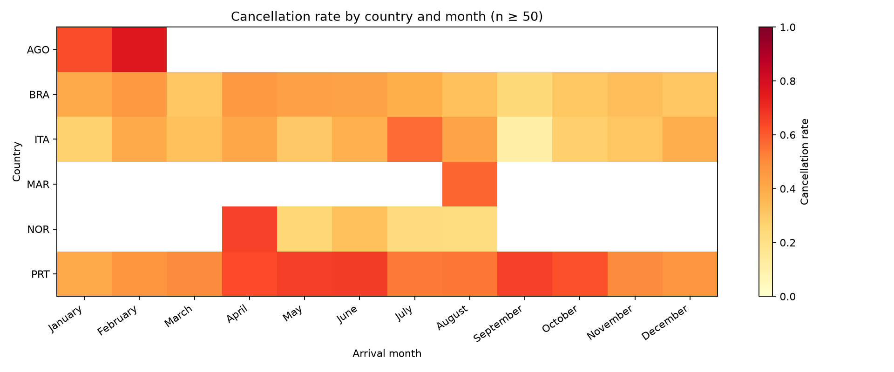
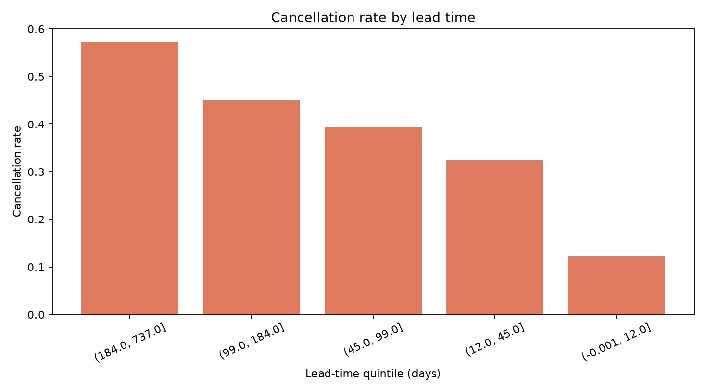
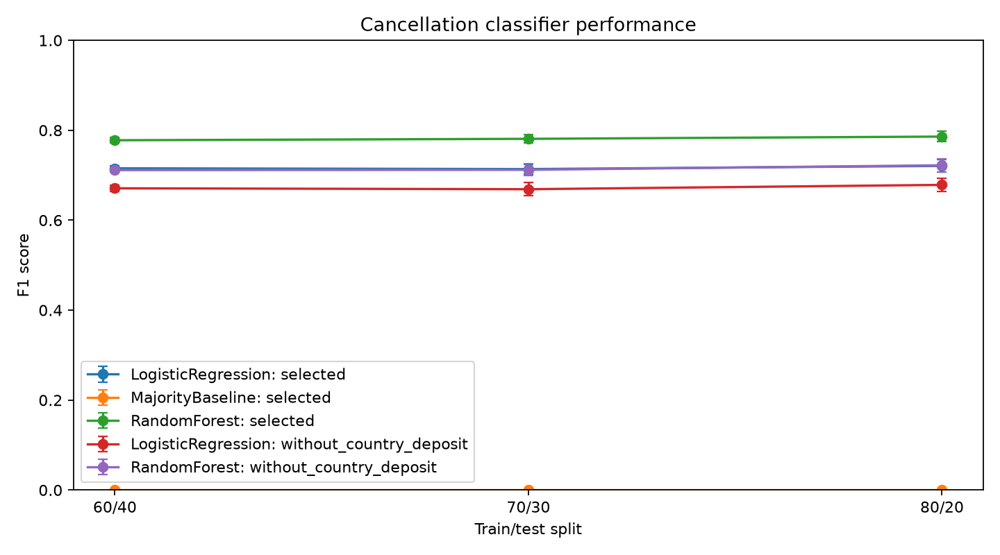
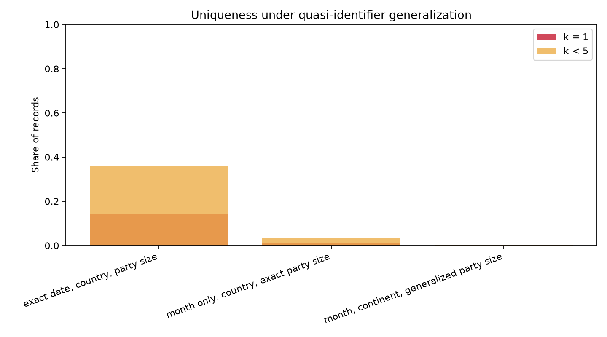

# Section 1: Hotel Booking Cancellations Scrutiny

## 1.1 Assumptions and pre-processing

The data set contains 119,390 bookings for a resort hotel and a city hotel in Portugal with arrivals between 2015 and 2017 [1]. I assumed that `is_canceled` is a reliable label and that the manager needs drivers that are known when a booking is made. Fields recorded after the booking, such as `reservation_status`, `assigned_room_type` and `booking_changes`, were therefore excluded from driver selection and modelling, because they leak the outcome [2].

Pre-processing was done in Python with pandas (Appendix A.1). I removed one negative-ADR row and 180 bookings with zero guests. I merged the country code `CN` into `CHN` (1,279 rows) and `Undefined` meals into `SC` (1,169 rows), which the data descriptor treats as equivalent [1]. ADR was capped at its 99.5th percentile (€275) for descriptive work. Repeated rows were kept, as no reservation ID proves they are errors. After cleaning, 119,209 bookings remained, with an overall cancellation rate of 37.1%.

## 1.2 Techniques and justification

Cancellation is a binary outcome, so I summarised it as a proportion and reported 95% Wilson score intervals [3]. Unlike the normal approximation, these remain reliable for small cells. To avoid ranking noise, country-month cells with fewer than 50 bookings were omitted. Countries were ranked by the *lower* confidence bound of their worst month, which rewards rates that are both high and well supported. To compare attributes of different types on one scale, I used Cramér's V for categorical attributes [4] and a single-feature ROC AUC for numeric ones [5], rescaled as 2|AUC − 0.5| (Appendix A.2).

## 1.3 Top six countries and monthly patterns

The six countries were Portugal, Angola, Norway, Italy, Morocco and Brazil (Figure B.1, Table C.1). Portugal stands out both for its size (48,483 bookings) and its rate. Its peaks were in June (66.5%), May (66.1%) and September (65.9%), which are shoulder-season months.

I offer two rationales. First, 97.3% of non-refundable bookings are Portuguese, and these are mostly group and offline tour-operator allocations. These blocks are often released in bulk when they go unsold [6]. Second, the data descriptor notes that a guest's country is often only confirmed at check-in. A cancelled booking may therefore keep a default domestic code [1], which would inflate Portugal's rate artificially. Angola's January–February peak (76.9%) and Norway's April peak (65%) rest on 50–75 bookings each, and their intervals are wide (e.g. 64–86% for Angola), so I treat them as signals to monitor rather than firm findings.

## 1.4 Key attributes and lead time

Lead time is the number of days between the date a booking was entered into the system and the arrival date [1]. It is a good but incomplete predictor; its single-feature AUC is 0.689, and its effect is monotonic: the cancellation rate rises from 12.3% for bookings made 12 days or less ahead to 57.3% for bookings made more than 184 days ahead (Figure B.2). Longer gaps give plans more time to change and guests more chance to find a better offer [7].

Three further attributes are linked to high cancellation rates (Table C.2):

- **Deposit type** (V = 0.48): non-refundable bookings cancel at 99.4%, compared with 37.1% overall.
- **Market segment** (V = 0.27): group bookings cancel at 61.1%.
- **Total special requests** (strength 0.27): this works protectively. Bookings with no requests cancel at about 48%, against about 22% for those with one or more.

I chose these over country (V = 0.36) because of the recording artefact described above. I also rejected `assigned_room_type` and `booking_changes`, because both are only known after the booking is made. Together, these point to three problem areas: group and tour-operator allocations, long-lead bookings and low-engagement bookings.

# Section 2: Critical Evaluation of Classification Models

## 2.1 Approach and assumptions

I compared logistic regression (LR) and random forest (RF), implemented in scikit-learn [8] (Appendix A.3). Each was trained on thirteen booking-time attributes chosen in Section 1, including lead time, deposit type, market segment, special requests, country and ADR. I assumed that missed cancellations and false alerts both carry a cost, so both models used class-balanced weights for the 37% minority class, and a majority-class baseline set the minimum acceptable performance.

Each split ratio (80/20, 70/30 and 60/40) was repeated with five seeds, and I report the mean and standard deviation. Bookings with identical feature profiles were kept on the same side of each split. Without this, near-duplicate rows would appear in both training and test sets and inflate the scores [2]. Realised test shares are therefore approximate (e.g. 20.2%). Imputation and ADR capping were fitted only within each training split.

## 2.2 Results

| Split | Model | Accuracy | Precision | Recall | F1 (± SD) | ROC AUC |
|---|---|---|---|---|---|---|
| 80/20 | Logistic regression | 0.786 | 0.704 | 0.738 | 0.721 ± 0.014 | 0.866 |
| 80/20 | Random forest | **0.842** | **0.793** | **0.779** | **0.786 ± 0.012** | **0.919** |
| 70/30 | Logistic regression | 0.784 | 0.698 | 0.730 | 0.714 ± 0.011 | 0.863 |
| 70/30 | Random forest | 0.840 | 0.789 | 0.773 | 0.781 ± 0.009 | 0.916 |
| 60/40 | Logistic regression | 0.785 | 0.700 | 0.732 | 0.715 ± 0.005 | 0.864 |
| 60/40 | Random forest | 0.838 | 0.788 | 0.768 | 0.778 ± 0.006 | 0.915 |
| All | Majority baseline | 0.630 | 0.000 | 0.000 | 0.000 | 0.500 |

Both models beat the baseline, which reaches 63% accuracy while identifying no cancellations. RF outperformed LR at every split, by about 0.065 in F1 and 0.05 in AUC. The split ratio changed results by less than 0.01, which is within about one standard deviation. With about 120,000 rows, even 60% is ample training data; the algorithm matters far more than the split (Figure B.3).

## 2.3 Critical evaluation

LR's main strength is transparency. Its coefficients show that previous cancellations and lead time increase risk, while special requests reduce it (Table C.3). Its weakness is that it assumes additive, linear effects on the log-odds, so it cannot represent interactions such as deposit type × country × segment unless they are engineered by hand [9].

RF averages many decorrelated trees, which captures these non-linear interactions and reduces variance [10]. That explains its advantage here. However, it is harder to explain to a manager. Its impurity-based importance is also biased towards high-cardinality attributes [11], which probably explains why country ranks so highly.

The evaluation has three limitations:

- **Validation design.** Random percentage splits ignore time. A model trained on 2015–2016 and tested on 2017 would better reflect deployment, and k-fold cross-validation would use the data more efficiently.
- **Leakage-prone attributes.** Deposit type and country both carry the recording artefacts noted in Section 1, so part of the reported performance may not transfer to a new hotel.
- **No tuning or calibration.** I did not tune hyperparameters or check probability calibration.

The baseline, repeated seeds and threshold analysis worked well, turning scores into operational trade-offs. At the 70/30 split, lowering RF's decision threshold from 0.5 to 0.3 raises recall from 0.77 to 0.91. The cost is roughly 6,900 false alerts instead of 2,700 (Table C.4).

**Recommendation.** I recommend RF as a risk-triage tool, with its threshold set from the relative costs of an empty room and an unnecessary intervention, and LR kept alongside to explain drivers to staff.

# Section 3: Privacy Challenges

## 3.1 Three responsibilities under the Data Protection Act 2018

The Data Protection Act 2018 (DPA) sits alongside the UK GDPR and governs how the hotel processes guests' personal data [12], [13].

**Lawfulness, transparency and purpose limitation.** Guests provide data to book a room; reusing it to score cancellation risk is a further purpose that needs a lawful basis, such as legitimate interests supported by a balancing test, and it must be disclosed in the privacy notice [13]. If a score led automatically to a significant decision, such as refusing a booking or changing its price, the safeguards on automated decision-making would also apply [13].

**Data minimisation and storage limitation.** The model needs neither names nor contact details, and old booking histories should be deleted on a defined schedule [13].

**Security and controlled disclosure.** Booking data flows to travel agents, online platforms and analytics vendors. The hotel must secure it and must govern each disclosure through a contract [13].

My uniqueness analysis (Appendix A.4, Figure B.4) shows that 14.3% of bookings are unique on just four attributes: hotel, country, exact arrival date and party size. In addition, 36.1% belong to groups of fewer than five bookings. Anyone who knows when a guest travelled could single out their record, including whether they cancelled and what they paid, without a name [14].

## 3.2 Why the manager should understand the Act

The first reason is **legal and financial exposure**. Fines can reach £17.5 million or 4% of global annual turnover, whichever is higher [13]. In 2020 the ICO fined Marriott International £18.4 million after a breach exposed about 339 million guest records [15]. Hospitality is an active enforcement target.

The second reason is **trust and guests' rights**. Guests can request access to their data, have it erased, or object to profiling. Frontline staff must be able to recognise these requests and respond within one month [13].

## 3.3 Two solutions and their evaluation

**Solution 1: pseudonymisation and generalisation before analysis.** This removes direct identifiers and coarsens quasi-identifiers, following k-anonymity [14]. Generalising arrival date to month cut the share of unique records from 14.3% to 1.1%. Also coarsening country to continent and party size to bands reduced it to 0.03%. There are two limitations. First, k-anonymity does not prevent attribute disclosure: if every booking in a group cancelled, membership alone reveals the outcome. This requires further safeguards such as ℓ-diversity [16]. Second, pseudonymised data remains personal data in law [13].

**Solution 2: a Data Protection Impact Assessment (DPIA) with role-based access controls.** Profiling customers at scale is likely to require a DPIA [13]. A DPIA records purpose, risks and mitigations, while access controls limit row-level data to staff who need it. It costs more time, but addresses risks that anonymisation cannot.

The solutions are complementary, and together show the Act's merit: its accountability principle asks the hotel to *demonstrate* that it handles data responsibly, which turns data protection from a compliance cost into evidence of good management [12].

# References

[1] N. Antonio, A. de Almeida and L. Nunes, "Hotel booking demand datasets," *Data in Brief*, vol. 22, pp. 41–49, 2019, doi: 10.1016/j.dib.2018.11.126.

[2] S. Kaufman, S. Rosset, C. Perlich and O. Stitelman, "Leakage in data mining: Formulation, detection, and avoidance," *ACM Trans. Knowl. Discov. Data*, vol. 6, no. 4, Art. 15, 2012, doi: 10.1145/2382577.2382579.

[3] E. B. Wilson, "Probable inference, the law of succession, and statistical inference," *J. Amer. Statist. Assoc.*, vol. 22, no. 158, pp. 209–212, 1927.

[4] H. Cramér, *Mathematical Methods of Statistics*. Princeton, NJ, USA: Princeton Univ. Press, 1946.

[5] T. Fawcett, "An introduction to ROC analysis," *Pattern Recognit. Lett.*, vol. 27, no. 8, pp. 861–874, 2006, doi: 10.1016/j.patrec.2005.10.010.

[6] N. Antonio, A. de Almeida and L. Nunes, "Big data in hotel revenue management: Exploring cancellation drivers to gain insights into booking cancellation behavior," *Cornell Hosp. Q.*, vol. 60, no. 4, pp. 298–319, 2019, doi: 10.1177/1938965519851466.

[7] N. Antonio, A. de Almeida and L. Nunes, "Predicting hotel booking cancellations to decrease uncertainty and increase revenue," *Tourism Manage. Stud.*, vol. 13, no. 2, pp. 25–39, 2017, doi: 10.18089/tms.2017.13203.

[8] F. Pedregosa *et al.*, "Scikit-learn: Machine learning in Python," *J. Mach. Learn. Res.*, vol. 12, pp. 2825–2830, 2011.

[9] T. Hastie, R. Tibshirani and J. Friedman, *The Elements of Statistical Learning*, 2nd ed. New York, NY, USA: Springer, 2009.

[10] L. Breiman, "Random forests," *Mach. Learn.*, vol. 45, no. 1, pp. 5–32, 2001, doi: 10.1023/A:1010933404324.

[11] C. Strobl, A.-L. Boulesteix, A. Zeileis and T. Hothorn, "Bias in random forest variable importance measures: Illustrations, sources and a solution," *BMC Bioinformatics*, vol. 8, Art. 25, 2007, doi: 10.1186/1471-2105-8-25.

[12] *Data Protection Act 2018*, c. 12. [Online]. Available: https://www.legislation.gov.uk/ukpga/2018/12/contents

[13] Information Commissioner's Office, "UK GDPR guidance and resources." [Online]. Available: https://ico.org.uk/for-organisations/uk-gdpr-guidance-and-resources/ [Accessed: Oct. 4, 2026].

[14] L. Sweeney, "k-anonymity: A model for protecting privacy," *Int. J. Uncertain. Fuzziness Knowl.-Based Syst.*, vol. 10, no. 5, pp. 557–570, 2002, doi: 10.1142/S0218488502001648.

[15] Information Commissioner's Office, "ICO fines Marriott International Inc £18.4million for failing to keep customers' personal data secure," Oct. 30, 2020. [Online]. Available: https://ico.org.uk/

[16] A. Machanavajjhala, D. Kifer, J. Gehrke and M. Venkitasubramaniam, "ℓ-diversity: Privacy beyond k-anonymity," *ACM Trans. Knowl. Discov. Data*, vol. 1, no. 1, Art. 3, 2007, doi: 10.1145/1217299.1217302.

# Appendix A: Code Snippets

**A.1 Pre-processing** (`src/preprocessing.py`, `clean_reservations`). [INSERT SCREENSHOT: country/meal merges, negative-ADR and zero-guest filters, ADR cap.]

**A.2 Association measures** (`src/analysis.py`, `add_wilson_intervals` and `attribute_associations`). [INSERT SCREENSHOT.]

**A.3 Classifier pipelines and evaluation** (`src/modelling.py`, `build_models`; `src/evaluation.py`, the `GroupShuffleSplit` loop). [INSERT SCREENSHOT plus terminal output of `python -m src.evaluation`.]

**A.4 Uniqueness analysis** (`src/privacy.py`, `_k_statistics`). [INSERT SCREENSHOT plus terminal output.]

# Appendix B: Figures

# Appendix C: Detailed Results

**Table C.1: Peak cancellation month for each top-six country, with 95% Wilson interval** (full table: `output/top_six_country_month_rates.csv`)

| Country | Peak month | Bookings | Rate | 95% CI |
|---|---|---|---|---|
| PRT | June | 4,369 | 66.5% | 65.1–67.9% |
| AGO | February | 52 | 76.9% | 63.9–86.3% |
| NOR | April | 60 | 65.0% | 52.4–75.8% |
| ITA | July | 341 | 56.6% | 51.3–61.8% |
| MAR | August | 80 | 57.5% | 46.6–67.7% |
| BRA | April | 215 | 46.0% | 39.5–52.7% |

**Table C.2: Attribute association with cancellation** (top ten; full table: `output/attribute_association.csv`)

| Attribute | Measure | Strength | Booking-time? |
|---|---|---|---|
| deposit_type | Cramér's V | 0.482 | Yes |
| lead_time | 2\|AUC − 0.5\| (AUC 0.689) | 0.378 | Yes |
| country | Cramér's V | 0.360 | Yes (artefact risk) |
| total_of_special_requests | 2\|AUC − 0.5\| (AUC 0.364) | 0.272 | Yes |
| market_segment | Cramér's V | 0.267 | Yes |
| assigned_room_type | Cramér's V | 0.202 | No |
| distribution_channel | Cramér's V | 0.177 | Yes |
| hotel | Cramér's V | 0.137 | Yes |
| booking_changes | 2\|AUC − 0.5\| (AUC 0.432) | 0.137 | No |
| customer_type | Cramér's V | 0.137 | Yes |

**Table C.3: Mean feature effects across 15 runs** (top five per model; full table: `output/feature_importance.csv`)

| Rank | Logistic regression (mean \|coef\|) | Random forest (impurity importance) |
|---|---|---|
| 1 | deposit_type 2.00 | lead_time 0.171 |
| 2 | previous_cancellations 0.86 (+) | country 0.166 |
| 3 | lead_time 0.73 (+) | deposit_type 0.162 |
| 4 | total_of_special_requests 0.60 (−) | adr 0.100 |
| 5 | country 0.60 | market_segment 0.092 |

**Table C.4: Decision-threshold trade-off, 70/30 split, mean of five seeds** (full table: `output/threshold_tradeoff.csv`)

| Model | Threshold | Precision | Recall | False alerts | Missed cancellations |
|---|---|---|---|---|---|
| Random forest | 0.3 | 0.637 | 0.914 | 6,886 | 1,138 |
| Random forest | 0.5 | 0.789 | 0.773 | 2,730 | 3,007 |
| Random forest | 0.7 | 0.907 | 0.581 | 786 | 5,542 |
| Logistic regression | 0.5 | 0.698 | 0.730 | 4,178 | 3,573 |
